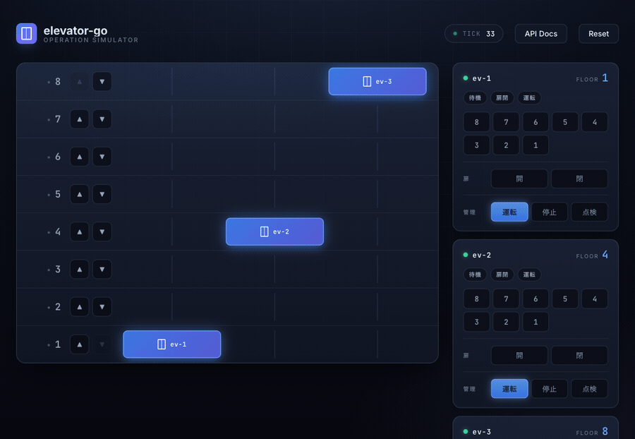

# elevator-go

複数台のエレベーターをホール呼びとかご内行先で動かすシミュレータ。エレベーターの運行ロジックをドメインとして整理してみたかったのが出発点。実装は Go、構成は DDD + クリーンアーキテクチャ。



ブラウザ UI からホールボタンとかご内行先ボタンを押せる。複数タブを開いても SSE で状態が同期する。

## 動かす

必要なもの: Go と Node.js / pnpm（バージョンは `go.mod` と `web/package.json` を参照）。

```bash
cd web && pnpm install && pnpm run build && cd ..  # 初回のみ
go run .
```

`:8080` で立ち上がる。UI は `/`、Swagger UI は `/docs`。
auto-tick の goroutine が裏で回っていて、既定で 1 秒ごとに状態が進む。

環境変数で挙動を変えられる。例えば `FLOOR_MIN=-2 FLOOR_MAX=20 ELEVATOR_COUNT=4 go run .` なら地下 2 階〜20 階の 4 号機構成になる。

| 変数                      | 既定       | 用途                                                       |
| ------------------------- | ---------- | ---------------------------------------------------------- |
| `ADDR`                    | `:8080`    | リッスンアドレス                                           |
| `TICK_INTERVAL_MS`        | `1000`     | auto-tick の間隔                                           |
| `FLOOR_MIN` / `FLOOR_MAX` | `1` / `10` | 階数範囲（地下は負値）                                     |
| `ELEVATOR_COUNT`          | `2`        | 号機台数                                                   |
| `LOG_FORMAT`              | `text`     | `json` で構造化ログ                                        |
| `LOG_DEBUG`               | unset      | セットすると DEBUG レベル                                  |
| `CORS_ALLOWED_ORIGINS`    | unset      | 許可 Origin のカンマ区切り（`*` で全許可、空なら CORS 無効） |

## 構成

```
interface/http  →  usecase  →  domain
                      ↑
             infrastructure
```

- `internal/domain/elevator` … Entity / VO / 集約（ElevatorBank）/ Domain Service。stdlib のみ。
- `internal/usecase` … Find → 処理 → Save の協調。Clock・IDGenerator・Locker などは Port として宣言してインフラに差し替えてもらう。
- `internal/infrastructure` … in-memory repository、mutex locker、system clock、UUID generator。
- `internal/interface/http` … OpenAPI から生成した型（`oapi/`）と chi ハンドラ（`server/`）。Broadcaster / SSE / auto-ticker / 静的配信もここ。
- `web/` … Vite + React + TypeScript。`pnpm run build` の出力が `server/webdist/` に置かれて、`embed.FS` でバイナリに同梱される。

`time.Now()` も ID 生成もドメインからは呼ばない。テストで決定論的に差し替えるための設計上の選択で、Clock / IDGenerator を Port にしている。配車は「距離 → idle 優先 → ID 昇順」と決め打ちにしていて、同じ状態からは必ず同じ号機が割り当たる。

設計の細かいところはドキュメントに分けてある:

- [docs/domain.md](docs/domain.md) … ドメインモデル
- [docs/behavior.md](docs/behavior.md) … 状態遷移と配車ルール、tick セマンティクス
- [docs/test-cases.md](docs/test-cases.md) … テストケース
- [docs/api.md](docs/api.md) … API 解説

## API

エンドポイントの一次ソースは OpenAPI 仕様（[docs/openapi.yaml](docs/openapi.yaml)）。Swagger UI（`/docs`）でブラウズするのが手っ取り早い。

```bash
curl -X POST localhost:8080/floors/1/hall-calls -H 'Content-Type: application/json' -d '{"direction":"up"}'  # ホール呼び
curl localhost:8080/elevators                                                                                 # 号機の一覧
curl -N localhost:8080/events                                                                                 # SSE で状態を購読
```

操作の種類は、ホール呼び・かご内行先・ドア開閉・運転停止/再開・号機の追加と状態更新・手動 tick・リセット。詳しくは [docs/api.md](docs/api.md) を参照。

## Docker

frontend と backend を別イメージに分けてあり、`compose.yaml` でまとめて起動できる。

```bash
docker compose up -d --build      # build + 起動
open http://localhost:5173        # UI（nginx 配信）
docker compose down               # 停止
```

- **backend** (`Dockerfile.backend`) … Go 静的バイナリを distroless で配信。UI 資産は持たない。`CORS_ALLOWED_ORIGINS` を env で渡す。
- **frontend** (`Dockerfile.frontend`) … Vite build を `nginx:alpine` で静的配信。`ARG VITE_API_BASE` で backend オリジンを build 時に bundle へ焼き込む。指定なしなら `/`（同一オリジン）にフォールバック。
- frontend を別オリジンに置くときは `--build-arg VITE_API_BASE=https://api.example.com` で URL を差し替え、backend 側の `CORS_ALLOWED_ORIGINS` にそのオリジンを足す。

## 開発

```bash
make check    # go build + go vet + go test
make lint     # golangci-lint
make help     # その他のターゲット
```

- OpenAPI（`docs/openapi.yaml`）を編集したら `go generate ./...` で `internal/interface/http/oapi/api.gen.go` を再生成する。
- `server.Handler` は `oapi.Unimplemented` を埋め込んでいない。operation を足すと、ハンドラを実装するまでコンパイルが通らない（実装漏れをコンパイラで検出するため）。
- ドメインのエラーから HTTP ステータスへの変換は `internal/interface/http/server/errors.go` の `errorMapping` に集約している。ハンドラ側に switch を散らさない。

フロントは `web/` 配下:

```bash
cd web
pnpm install     # 初回のみ
pnpm run dev     # Vite dev server (:5173)、API は :8080 に proxy
pnpm run build   # webdist/ に出力
```

ビルドし直して `go run .` を再起動すれば新しい UI が embed される。

## ライセンス

[MIT License](LICENSE)
